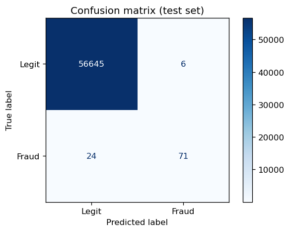
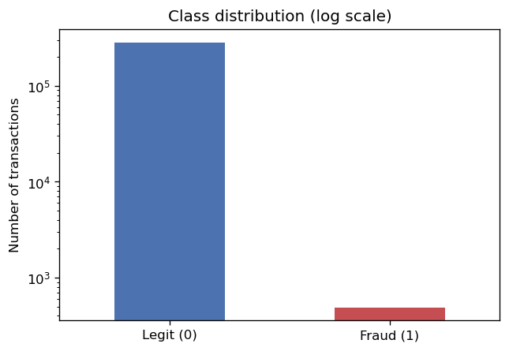

# Credit Card Fraud Detection

Machine learning project that detects fraudulent credit card transactions
in a highly imbalanced dataset (492 frauds out of 284,807 transactions, 0.17%).

## Dataset
Kaggle "Credit Card Fraud Detection" (ULB). Download `creditcard.csv` from
https://www.kaggle.com/datasets/mlg-ulb/creditcardfraud.

## Approach
1. Load data and run exploratory analysis
2. Remove duplicate rows
3. Stratified train/test split, then scale Time and Amount (fit on train only)
4. Handle class imbalance with class weights
5. Compare Logistic Regression, Random Forest, and Gradient Boosting on a validation set
6. Tune the best model with RandomizedSearchCV (scored on PR-AUC)
7. Choose the decision threshold using out-of-fold predictions
8. Evaluate once on the untouched test set
9. Analyze feature importance and save the model
## Results

Evaluated once on a held-out test set of 56,746 transactions (95 frauds).

| Metric | Value |
|---|---|
| Model | Random Forest (tuned with RandomizedSearchCV) |
| PR-AUC | 0.813 |
| ROC-AUC | 0.939 |
| Fraud precision | 92.2% |
| Fraud recall | 74.7% |
| Frauds caught / missed | 71 / 24 |
| False alarms | 6 |
| Decision threshold | 0.30 (chosen from out-of-fold training predictions) |

Best parameters: `n_estimators=100, max_depth=20, min_samples_leaf=2, max_features='sqrt'`

Validation comparison (PR-AUC): Random Forest 0.872, Logistic Regression 0.787, Gradient Boosting 0.768.

The model catches about three out of four frauds while raising very few false alarms.
Accuracy is not used as the main metric, since predicting "no fraud" every time already gives 99.8%.
### Plots

## How to run
pip install -r requirements.txt
python fraud_detection.py

## Limitations
- The test set contains only 95 frauds, so scores can shift noticeably between runs.
- Hyperparameter tuning tried only 3 combinations to keep the runtime short; a larger search might improve results.
- Features V1-V28 are anonymized, which limits interpretation.
